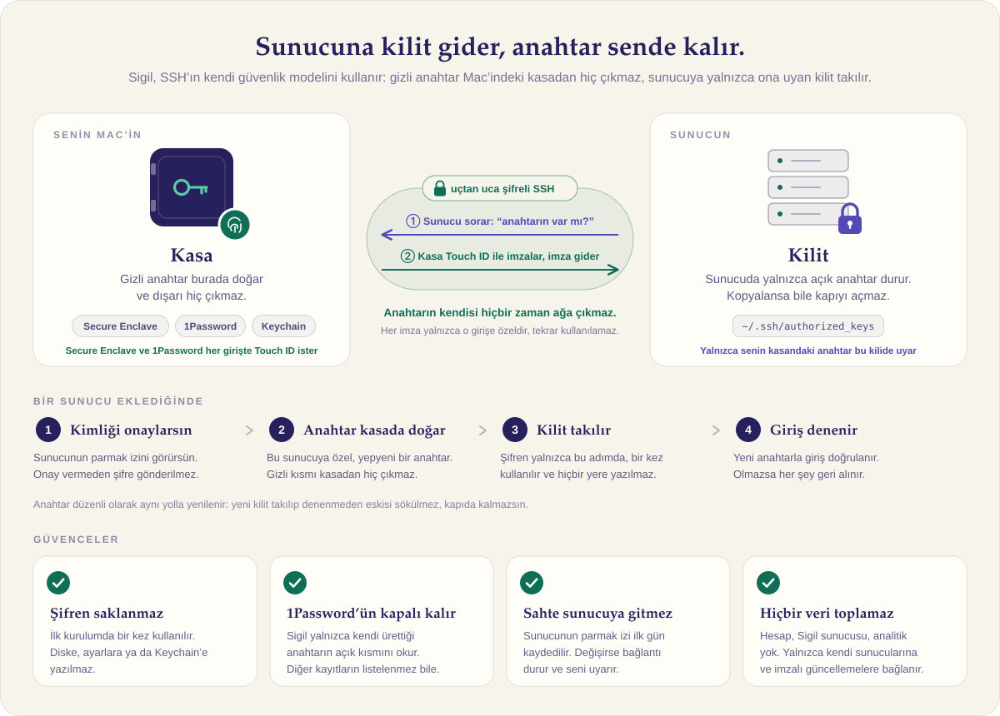

<div align="center">


# Sigil

**Her sunucuya kendi mührü.**

SSH sunucularını tek yerden yöneten, anahtarları senin yerine üreten, kuran ve yenileyen bir macOS uygulaması.

[](https://github.com/NNakreSS/sigil/actions/workflows/ci.yml)
[](https://github.com/NNakreSS/sigil/releases/latest)


[**İndir**](https://github.com/NNakreSS/sigil/releases/latest) · [Güvenlik](#güvenlik-sade-bir-dille) · [Özellikler](#özellikler) · [Geliştirme](#geliştirme)

</div>

---

Sunucuyu bir kez eklersin: alias, IP, kullanıcı adı ve şifre. Sigil gerisini halleder:

1. Sunucunun parmak izini gösterir, sen onaylarsın.
2. O sunucuya **özel** bir anahtar üretir (1Password'de ya da macOS Keychain'de).
3. Açık anahtarı sunucuya kurar ve yeni anahtarla girişi doğrular. Şifre bu adımdan sonra bir daha kullanılmaz ve hiçbir yere kaydedilmez.
4. `~/.ssh/config` dosyasına kısayolu yazar ve anahtarı düzenli olarak yeniler.

Sonra terminalde yazman gereken tek şey:

```
ssh webserver
```

## Güvenlik, sade bir dille

<p align="center">
  
</p>

Bir SSH aracına sunucu şifreni ve 1Password'ünü emanet etmeden önce aklına gelen soruların cevapları aşağıda. Her cevap kodda doğrulanabilir.

<details>
<summary><b>1Password'ü bağlarsam diğer şifrelerim, kartlarım, notlarım okunur mu?</b></summary>
<br>

Hayır. Sigil 1Password'le yalnızca resmi `op` komut satırı aracıyla konuşur ve yalnızca aşağıdaki komutları çalıştırır. Bunların dışında bir komut yok ([`OnePasswordService.swift`](Sources/SigilCore/OnePasswordService.swift)):

| Komut | Neden | Sigil'in gördüğü |
|---|---|---|
| `op account list` | 1Password bağlı mı? | Yalnızca "bağlı / değil" bilgisini kullanır |
| `op vault list` | SSH Agent'ın kasasını (Private / Personal / Employee) bulmak | Kasa adları |
| `op item create --category ssh` | Yeni anahtar üretmek | **Hiçbir şey.** Çıktı private key içerdiği için okunmadan atılır |
| `op item list --tags sigil-…` | Az önce üretilen kaydı bulmak | Yalnızca o etiketi taşıyan kaydın kimliği |
| `op item get --fields public_key,fingerprint` | Açık anahtarı sunucuya kurmak | Açık anahtar ve parmak izi |
| `op item delete --archive` | Yenilenen eski anahtarı kaldırmak | Hiçbir şey. Kayıt silinmez, Arşiv'e taşınır |

- Başka bir kaydın içeriğini isteyen tek bir satır bile yok. Diğer kayıtların adları bile listelenmez.
- `op` her yeni oturum için 1Password'ün kendi penceresinde Touch ID onayı ister. Onay vermezsen hiçbir şey çalışmaz.
- Daha fazla ayrım istersen 1Password'ü hiç bağlamadan macOS Keychain seçeneğini kullanabilirsin.
</details>

<details>
<summary><b>Private key'im bir yere gider mi?</b></summary>
<br>

- **1Password seçeneğinde:** Anahtar 1Password'ün içinde üretilir ve hiç diske yazılmaz. `ssh` bağlanırken sunucu bir soru gönderir. 1Password SSH Agent, sen Touch ID ile onaylayınca bu soruyu imzalar. Dışarı çıkan şey anahtar değil, yalnızca o tek girişe ait imzadır.
- **Keychain seçeneğinde:** Anahtar `~/.ssh/sigil/keys` altında, 192 bit rastgele bir parolayla şifrelenmiş olarak durur. Parola macOS Keychain'de saklanır.

İki durumda da sunucuya yalnızca **açık** anahtar gider. Açık anahtar, adı üstünde, gizli değildir: onunla giriş yapılamaz.
</details>

<details>
<summary><b>Sunucu şifrem saklanıyor mu?</b></summary>
<br>

Hayır. Şifre yalnızca ilk kurulumda, bellekte tutulur ve bir kez kullanılır:

- `ssh`'a komut satırıyla değil `SSH_ASKPASS` mekanizmasıyla verilir. `ps` gibi araçlarda görünmez, diske yazılmaz.
- Sunucunun parmak izini onaylamadan **gönderilmez**. Böylece araya giren sahte bir sunucu şifreni alamaz.
- Kurulum bitince unutulur. Bir adım başarısız olursa yarım kalan her şey geri alınır.
</details>

<details>
<summary><b>SSH bağlantım dinlenebilir ya da ele geçirilebilir mi?</b></summary>
<br>

- SSH trafiği uçtan uca şifrelidir. Sigil bunu değiştirmez, OpenSSH'ın kendisini kullanır.
- Her bağlantıda `StrictHostKeyChecking=yes` kullanılır. Sunucunun kimliği (host key) ilk gün sen onaylayınca kaydedilir. Sonradan değişirse, örneğin biri araya girmeye çalışırsa, bağlantı durdurulur ve bir uyarı çıkar. Yeni kimlik ancak bilerek onaylarsan kabul edilir.
- Sigil sunucudaki `authorized_keys` dosyasını da denetler. Sigil dışından eklenmiş anahtarları gösterir, bunları tanıdık olarak işaretleyebilir ya da kaldırabilirsin.
</details>

<details>
<summary><b>Sigil benim hakkımda bir yere veri gönderiyor mu?</b></summary>
<br>

Hayır. Sigil'in hesap sistemi, sunucusu ya da analitiği yok. Uygulama internete yalnızca iki yerden çıkar:

1. **SSH ile kendi sunucularına.**
2. **GitHub'a, güncelleme kontrolü için.** Sparkle `appcast.xml` dosyasını indirir. Güncellemeler EdDSA ile imzalıdır, imzası tutmayan bir dosya kurulmaz.

Kodda bunların dışında ağ isteği yapan bir satır (`URLSession` vb.) yok. 1Password seçeneğinde, ürettiğin anahtar 1Password'ün kendi şifreli senkronizasyonuyla kasana kaydedilir. Bu, 1Password'ün normal işleyişidir.
</details>

<details>
<summary><b>İndirdiğim uygulamanın bu koddan derlendiğini nasıl bilebilirim?</b></summary>
<br>

- Sürümler, bu depodaki [Release iş akışıyla](.github/workflows/release.yml) GitHub Actions üzerinde derlenir. Derleme kayıtları herkese açıktır.
- Uygulama Apple Developer ID ile imzalanır ve Apple tarafından notarize edilir. İmzayı kendin kontrol edebilirsin:

  ```bash
  codesign -dv --verbose=2 /Applications/Sigil.app
  ```
  ```bash
  spctl --assess --verbose /Applications/Sigil.app
  ```
- İmzalama anahtarları yalnızca GitHub'ın şifreli secret deposunda tutulur. Depoda ya da derleme kayıtlarında bulunmazlar.
</details>

<details>
<summary><b>Mac'im çalınırsa ya da bir anahtarın sızdığından şüphelenirsem?</b></summary>
<br>

- 1Password anahtarları Touch ID olmadan kullanılamaz. Keychain anahtarları da Mac'in kilidiyle korunur.
- **Acil durum** (⌥⇧⌘R) tek tıkla bütün sunucularda anahtarı yeniler. Eski anahtarlar sunuculardan silinir.
- Yenileme hiçbir zaman seni dışarıda bırakmaz. Önce yeni anahtar kurulur, yeni anahtarla giriş doğrulanır, ancak ondan sonra eskisi kaldırılır.
</details>

**Dürüst sınırlar**

- Aynı macOS kullanıcısıyla çalışan zararlı bir yazılım, Keychain seçeneğinde anahtarlara ulaşabilir. 1Password her kullanımda onay istediği için bu konuda daha güçlüdür.
- İlk kurulum için sunucuda şifreyle girişin açık olması gerekir. Kurulumdan sonra **Sertleştirme** sihirbazıyla kapatabilirsin.

## Özellikler

| | |
|---|---|
| **İki anahtar deposu** | Sunucu başına 1Password (Touch ID) ya da macOS Keychain (tam otomatik yenileme). |
| **Kilitlenmeyen yenileme** | Yeni anahtarla giriş doğrulanmadan eskisi silinmez. 1Password anahtarları için bildirim ve tek tıkla yenileme. |
| **Gömülü terminal** | Sekmeli terminal, ⌘1…9 ile sunucular arasında geçiş. İstersen Terminal, iTerm2, Ghostty veya Warp. |
| **Hızlı bağlan** | ⌘K ile ara ve bağlan. Production sunucuları kırmızıyla işaretlenir ve bağlanmadan önce onay ister. |
| **İçe aktarma** | `~/.ssh/config` dosyasındaki sunucular şifre gerekmeden taşınır. Eski blok silinmez, yedeklenip yorum satırına alınır. |
| **Yabancı anahtar denetimi** | `authorized_keys` içindeki tanımadığın anahtarlar listelenir. Tek tıkla kaldırılabilir. |
| **Host key izleme** | Sunucunun kimliği değişirse alarm verilir, bağlantı durur. |
| **Sağlık paneli** | Disk, bellek, yük, bekleyen güncellemeler, çöken servisler, SSL bitiş tarihleri. Sorun çıkınca bildirim gelir. |
| **Sertleştirme sihirbazı** | Şifreli girişi ve root girişini kısıtlar; ufw, fail2ban ve otomatik güvenlik güncellemelerini kurar. Sunucudaki bir bekçi süreç, Sigil 45 saniye içinde yeni bir bağlantıyla doğrulamazsa her şeyi geri alır. |
| **Tüneller** | Kayıtlı port yönlendirmeleri (`localhost:15432 → db:5432`) tek tıkla açılır. |
| **Hızlı eylemler** | Kayıtlı komutlar birden çok sunucuda paralel çalışır, çıktılar ayrı gösterilir. |
| **ProxyJump** | Bastion sunucusu üzerinden bağlantı; host key taraması da bastion üzerinden yapılır. |
| **Arka plan** | Menü çubuğunda çalışır, girişte açılabilir, bildirim gönderir. |
| **Bağlantılar** | `sigil://connect/<alias>`, `sigil://open/<alias>`, `sigil://quick`: Shortcuts, Raycast ve Alfred ile kullanılabilir. |
| **Otomatik güncelleme** | İmzalı ve notarize edilmiş sürümler GitHub Releases'ten Sparkle ile gelir. |

## Mühür

Her sunucunun yedi köşeli bir mührü vardır. Köşeleri, dönüşü ve vurgu noktası, sunucunun o anki anahtarının SHA-256 özetinden üretilir ([`SigilGeometry.swift`](Sources/SigilCore/SigilGeometry.swift)).

- Aynı anahtar her zaman aynı mührü verir. Anahtar yenilenince mühür biçim değiştirir.
- Sunucu eklerken sunucunun kendi host key'inden üretilen mühür de gösterilir. Bu, parmak izinin görsel halidir.
- Uygulama ikonu, menü çubuğu simgesi ve boş ekranlardaki "nefes alan" mühür aynı sistemden gelir.

Tasarım dili mürekkep, parşömen ve tek bir vurgu rengine (verdigris) dayanır. Başlıklarda serif yazı tipi, terminalde görünen her şeyde monospace kullanılır. Hareketler macOS'un "Hareketi azalt" ayarına uyar.

## Kurulum

1. [Son sürümün](https://github.com/NNakreSS/sigil/releases/latest) `.dmg` dosyasını indir.
2. Sigil'i **Applications** klasörüne sürükle ve aç. Yanlış yerden açarsan Sigil kendini taşımayı teklif eder.
3. İlk açılışta kısa bir kurulum ekranı anahtar deposunu (1Password ya da Keychain) seçmene yardım eder.

1Password seçeneği için 1Password 8, **Ayarlar → Geliştirici** altında *SSH Agent* ve *1Password CLI ile entegrasyon* seçeneklerinin açık olması ve `op` CLI'ın kurulu olması gerekir.

## Geliştirme

```bash
swift test                    # birim testleri + 127.0.0.1'de geçici sshd'ye karşı uçtan uca testler
./scripts/make-app.sh         # build/Sigil.app (ad-hoc imzalı)
open build/Sigil.app
```

Gerçek `~/.ssh` klasörüne dokunmadan denemek için:

```bash
SIGIL_SANDBOX=/tmp/sd-try build/Sigil.app/Contents/MacOS/Sigil
```

<details>
<summary>Teknik güvenlik notları</summary>
<br>

- Şifre ve passphrase'ler `SSH_ASKPASS` ile, 0700 izinli geçici bir yardımcı üzerinden verilir. Değer yalnızca alt sürecin ortam değişkenindedir.
- Her `ssh` çağrısı `-F /dev/null`, `StrictHostKeyChecking=yes` ve Sigil'in kendi `known_hosts` dosyasıyla yapılır.
- `~/.ssh/config` dosyasına yalnızca bir `Include` satırı eklenir; öncesinde zaman damgalı yedek alınır.
- Tüm girdiler katı doğrulanır: `-` ile başlayan değerler ve satır sonları reddedilir.
- Bilinen bir sunucu kayıtlı anahtarlarından birini göstermezse bağlantı reddedilir ve yeni türde anahtar sessizce eklenmez.
- Uygulama yalnızca kendi eklediği `known_hosts` kayıtlarını siler.
- Sunucudan gelen çıktı akış başına 1 MB ile sınırlıdır.
- Yayın derlemeleri hardened runtime ile imzalanır, notarize edilir ve build makinesine ait rpath'ler binary'den temizlenir.
</details>

Yayınlama adımları için [RELEASING.md](RELEASING.md) dosyasına bak.
